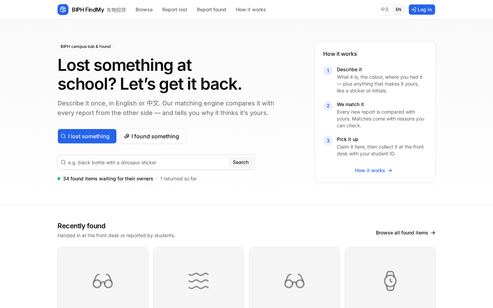
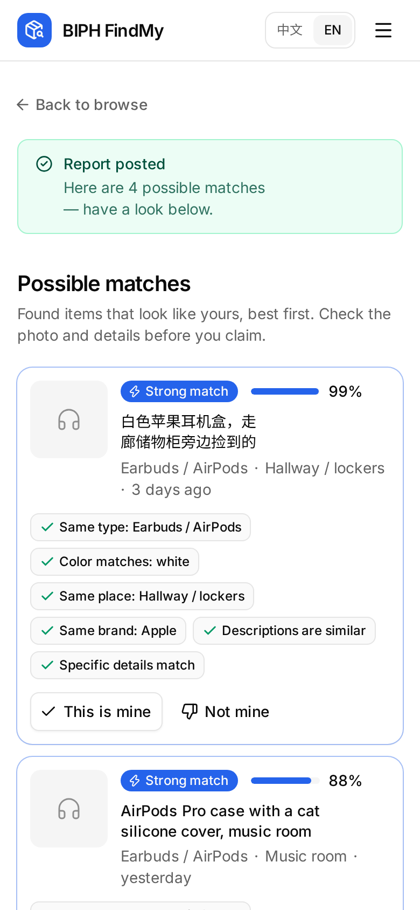
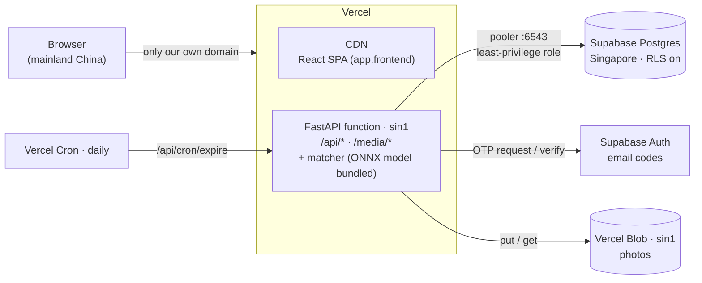

# BIPH FindMy · 失物招领

**<https://biph-findmy.vercel.app>**

BIPH FindMy is the campus lost & found for BASIS International School Park Lane Harbour. Students describe
what they lost or found, in English, 中文 or a mix of both. A bilingual matching engine compares every lost
report with every found report and explains why it thinks two of them are the same object. Hand-overs
happen at the front desk, and students never see each other's contact details.

BIPH 校园失物招领平台。丢了或捡到东西，用中文、英文或中英混写描述就行。系统会自动拿每条丢失描述和所有捡到描述比对，并说明为什么认为两者是同一件物品。交接统一在前台完成，学生之间看不到彼此的联系方式。

| Desktop | Phone |
|---|---|
|  |  |

## Two clubs, one product · 分工

This is the Q1 project of two clubs. The only interface between them is two functions:
`Matcher.analyze(text)` and `Matcher.rank(query, candidates)`.

| | **Data Science Club** — the matching engine | **Sea Dragon Coding Club** — the platform |
|---|---|---|
| Code | [`matcher/`](matcher/) | [`backend/`](backend/), [`frontend/`](frontend/) |
| Work | bilingual taxonomy, NLP extraction, evidence scoring, weight fitting, evaluation, the real-data activity | reporting, database, search and filters, claims, admin tools, website, deployment |
| Read | [evaluation report](docs/eval_report.md) · [notebooks](matcher/notebooks/) · [data collection guide](docs/data-collection.md) | [architecture](#architecture--架构) · [Supabase setup](docs/supabase-auth-setup.md) · [self-hosting](docs/self-hosting.md) |

## How matching works · 匹配原理

1. **Normalise**: full-width → half-width, Traditional → Simplified (OpenCC), lower-case.
2. **Extract**: category, colour, brand and distinguishing marks (stickers, initials, dents…) are pulled
   from free text with a bilingual dictionary. Students confirm or edit them as chips on the form.
3. **Score**: each piece of evidence adds log-odds: multilingual sentence embeddings
   (`paraphrase-multilingual-MiniLM-L12-v2`, int8 ONNX, so 黑色保温杯 ≈ black thermos), the residual
   "detail" text, category, near-colours (navy ≈ blue), brand, place and time. Missing information counts
   as zero. A found item reported more than a day *before* the loss is ruled out.
4. **Explain**: `sigmoid(Σ w·x)` gives a probability, shown as *strong* / *possible* with reasons such as
   "colour matches · same place". Weights are fitted by logistic regression (constrained ≥ 0).

**Results** (synthetic test campus, [full report](docs/eval_report.md)): the full model ranks the right item
first **89%** of the time (top 3: **99%**). A plain "same category + colour" filter manages **48%**. With 5
look-alikes, reports that mention a distinguishing mark are matched first 62% of the time, against 40% for
those that don't. Real-data numbers come from the club activity ([guide](docs/data-collection.md)).

```bash
uv run python -m matcher demo                                   # six black bottles
uv run python -m matcher analyze "黑色保温杯 贴了恐龙贴纸"
uv run python -m matcher.eval.run                               # regenerate the report
```

## Architecture · 架构



- **Mainland China access**: the browser only ever talks to our own origin. Supabase is called by the
  backend, photos are proxied through `/media/…`, and fonts and icons are bundled. There are no
  third-party CDNs, analytics or captchas, and a strict same-origin CSP enforces this. A custom domain is
  still recommended, because `*.vercel.app` can be blocked.
- **Auth**: Supabase Auth email OTP, proxied by the backend (BFF). Sessions live in httpOnly cookies, and
  writes need a custom header (CSRF). Only allow-listed school domains can sign in. Browsing works
  without an account.
- **Database**: SQLAlchemy models are the single schema source
  ([`scripts/gen_schema.py`](scripts/gen_schema.py) → [`supabase/migrations/`](supabase/migrations/)).
  Every table has RLS on with no access for the public API roles. The backend connects as `app_backend`,
  which can only read and write these tables.
- **Photos**: compressed in the browser (longest side 1600 px). The server sniffs the type, converts
  HEIC, applies the EXIF rotation, then strips EXIF/GPS and makes thumbnails. Photos of ID and bank
  cards are refused.

## Repository · 目录

```
matcher/           DS Club: normalize, extract, features, scoring, explain, embed (ONNX), eval/, data/
matcher/notebooks/ 01 data exploration · 02 text models compared · 03 weight fitting
backend/app/       FastAPI: routers (auth, items, claims, admin, cron, media), services, models, seed
frontend/          React 19 + Vite + Tailwind 4 + shadcn/ui (Radix, vendored in src/components/ui), zh/en, Playwright e2e
supabase/          generated Postgres migration
scripts/           fetch_model.py (pinned, checksummed), gen_schema.py, vercel_build.py, run_notebooks.py
docs/              evaluation report, data collection, Supabase setup, self-hosting, screenshots
Dockerfile         self-hosted fallback (docker-compose.yml + deploy/Caddyfile)
```

## Run it locally · 本地运行

Needs Python 3.13 with [uv](https://docs.astral.sh/uv/), and Node 20.19+.

```bash
make setup        # uv sync + npm ci
make model        # download the embedding model (118 MB); without it the matcher falls back to TF-IDF
ADMIN_EMAILS=desk.demo@findmy.local DEV_SHOW_CODE=true make dev    # API on :8000 with demo data
make web          # http://localhost:5173
```

Local mode uses SQLite and "local" auth. Login codes are shown on screen and printed in the API
console instead of being emailed. Demo accounts: `student.demo@findmy.local`, `finder.demo@findmy.local`,
and `desk.demo@findmy.local` (front desk / admin).

```bash
make test         # 60 Python tests: extraction, scoring, golden cases, API, permissions, images
make e2e          # Playwright: browse, report → match, claim → approve → returned, zh/en, screenshots
```

## Deploy · 部署

Production is a Vercel project connected to this repo: every push to `main` deploys. The build
([`scripts/vercel_build.py`](scripts/vercel_build.py)) downloads the pinned model and builds the SPA.
Settings are listed in [`.env.example`](.env.example). Production uses `APP_ENV=production`,
`AUTH_BACKEND=supabase`, `STORAGE_BACKEND=blob`, `DATABASE_URL` (the pooler with `app_backend`),
`SUPABASE_URL`, `SUPABASE_PUBLISHABLE_KEY`, `CRON_SECRET`, `ALLOWED_EMAIL_DOMAINS` and `ADMIN_EMAILS`.

Schema changes: edit `backend/app/models.py`, then run `make schema` and apply the new migration in Supabase.

If campus can't reach Vercel, the same app runs on a Hong Kong VPS or a school server with
`docker compose up -d --build`. See [docs/self-hosting.md](docs/self-hosting.md).

## Privacy · 隐私

- We only collect a school email and a display name. Contact details and the finder's private
  verification detail are never public.
- Reports are archived automatically after 60 days.
- Data is stored outside mainland China (Vercel and Supabase, Singapore), and some students are under 14.
  The school should approve the platform as data controller before launch, and a pilot with older grades
  is a sensible start. (This is not legal advice.)
