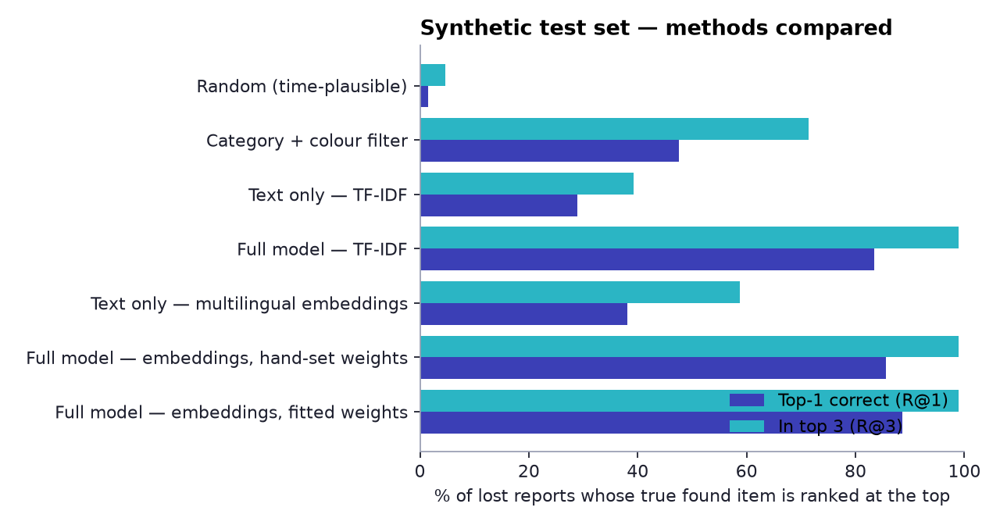
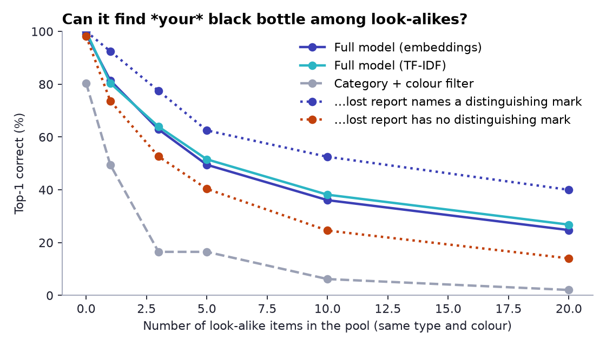
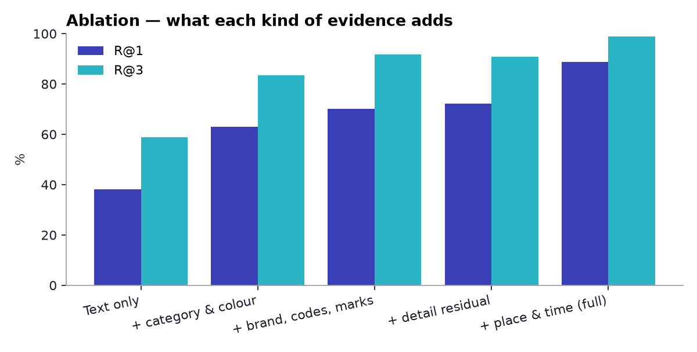
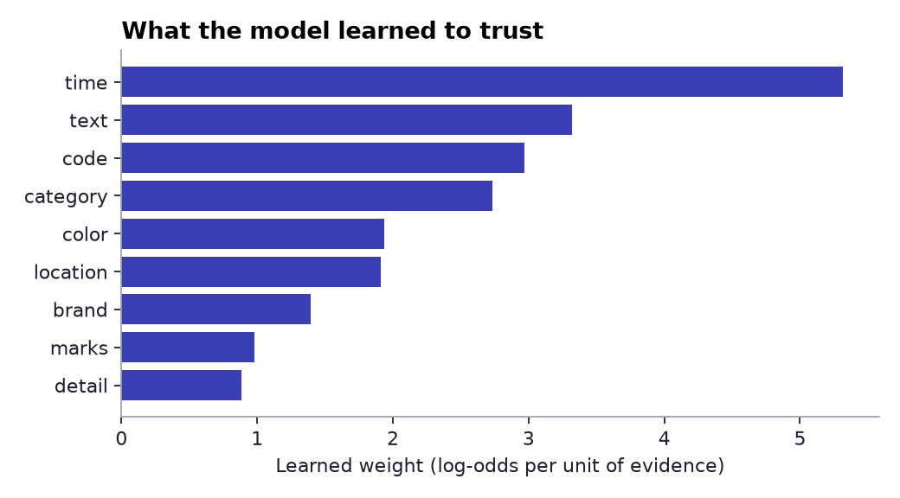

# Matching engine evaluation · 匹配引擎评估报告

_Generated 2026-10-08 by `python -m matcher.eval.run` — Data Science Club, BIPH._

## Summary · 结论

- On a synthetic test campus the full model puts the right found item **first for 89%** of lost reports and **in the top 3 for 99%** (95% CI R@1 81–94%).
- 在合成测试集上，完整模型把正确的物品排在第 1 位的比例是 **89%**，排进前 3 的比例是 **99%**。
- A plain "same category + same colour" filter gets 48% — the extra evidence (descriptions, distinguishing marks, place, time) is what separates look-alikes.
- On the hand-written (LLM-authored, not template) set: R@1 **100%**, R@3 **100%** over 42 found items.
- **Real data is still pending** — run the describe-an-object activity (docs/data-collection.md) and re-run this script; synthetic numbers are an upper-bound sanity check, not a promise.

## Datasets · 数据

- **Synthetic** (seed 2026, never used for training): 97 lost reports ranked against 163 found reports. 45% Chinese / 40% English / 15% mixed, ~20% Traditional among Chinese, ~35% use held-out words the dictionary has never seen, owners misremember colours/places, look-alike families share category + colour.
- **Hand-written**: 32 objects + 10 distractors in `matcher/data/handwritten_pairs.yaml`, written to sound like real student posts (emoji, slang, Traditional characters, typos). Written by an LLM — *not* real data.
- **Real**: `matcher/data/real_pairs.csv` (from the club activity) — not collected yet.
- Weights were fitted on a *different* synthetic world (seed 7, train split) — see `matcher/eval/fit_weights.py`.

## Methods compared · 方法对比

Metrics: **R@1** = true match ranked first; **R@3** = in the top three; **MRR** = mean of 1/rank. Candidates that are impossible in time (found more than a day *before* the loss) are excluded for every method.

| Method | R@1 | R@3 | MRR |
|---|---|---|---|
| Random (time-plausible) | 1.6% | 4.7% | 0.070 |
| Category + colour filter | 47.6% | 71.4% | 0.617 |
| Text only — TF-IDF | 28.9% | 39.2% | 0.366 |
| Full model — TF-IDF | 83.5% | 99.0% | 0.909 |
| Text only — multilingual embeddings | 38.1% | 58.8% | 0.518 |
| Full model — embeddings, hand-set weights | 85.6% | 99.0% | 0.922 |
| Full model — embeddings, fitted weights | 88.7% | 99.0% | 0.938 |



### Hand-written set

| Method | R@1 | R@3 | MRR |
|---|---|---|---|
| Random (time-plausible) | 4.5% | 13.5% | 0.159 |
| Category + colour filter | 74.4% | 90.9% | 0.837 |
| Text only — TF-IDF | 18.8% | 34.4% | 0.294 |
| Full model — TF-IDF | 100.0% | 100.0% | 1.000 |
| Text only — multilingual embeddings | 84.4% | 93.8% | 0.901 |
| Full model — embeddings, hand-set weights | 100.0% | 100.0% | 1.000 |
| Full model — embeddings, fitted weights | 100.0% | 100.0% | 1.000 |


## Look-alikes · 干扰项曲线

Each lost report is hidden among *k* look-alikes (same category and colour, different details) plus 20 random items.

| Look-alikes k | 0 | 1 | 3 | 5 | 10 | 20 |
|---|---|---|---|---|---|---|
| Full model (embeddings) | 99% | 81% | 63% | 49% | 36% | 25% |
| Full model (TF-IDF) | 100% | 80% | 64% | 52% | 38% | 27% |
| Category + colour filter | 80% | 49% | 16% | 16% | 6% | 2% |
| ↳ lost report names a distinguishing mark | 100% | 92% | 78% | 62% | 52% | 40% |
| ↳ lost report has no distinguishing mark | 98% | 74% | 53% | 40% | 25% | 14% |



**Takeaway · 结论：** with 5 look-alikes, reports that mention a sticker, keychain, initials or other mark are matched first 62% of the time, versus 40% for reports without one (n=40 vs 57). Two plain black bottles are indistinguishable — which is why the report form has a dedicated "distinguishing marks" field and asks for a photo.
有 5 个相似物品时，写了特征标记（贴纸、挂件、名字缩写等）的失物有 62% 被排在第一；没写的只有 40%。所以发布页专门有一个「特征标记」输入框。

## Ablation · 消融实验

Each row refits the weights using only the listed evidence.

| Method | R@1 | R@3 | MRR |
|---|---|---|---|
| Text only | 38.1% | 58.8% | 0.518 |
| + category & colour | 62.9% | 83.5% | 0.752 |
| + brand, codes, marks | 70.1% | 91.8% | 0.813 |
| + detail residual | 72.2% | 90.7% | 0.822 |
| + place & time (full) | 88.7% | 99.0% | 0.938 |



## Robustness · 稳健性

By language of the lost report:

| Method | R@1 | R@3 | MRR |
|---|---|---|---|
| en | 92.3% | 100.0% | 0.957 |
| mixed | 77.8% | 100.0% | 0.889 |
| zh | 90.9% | 97.0% | 0.944 |
| zh-hant | 85.7% | 100.0% | 0.929 |


Dictionary coverage (did the lost report use a held-out word?):

| Method | R@1 | R@3 | MRR |
|---|---|---|---|
| dictionary word | 93.2% | 100.0% | 0.966 |
| held-out word | 73.9% | 95.7% | 0.848 |


If users skip the structured fields and only type free text, R@1 is 75% (R@3 93%) — the NLP extraction fills in category, colour and place.

## False alarms · 误报

When the owner's item has **not** been handed in, the top candidate still lands in the *strong* band for 8% of reports and is shown at all (possible band) for 31%. That is why the site says "possible match — please check the photo" instead of "this is yours".

## What the model learned · 学到的权重

Weights are log-odds per unit of evidence, constrained to be ≥ 0 so more evidence never lowers a score.

| Feature | onnx | tfidf |
|---|---|---|
| text | 3.32 | 1.18 |
| detail | 0.89 | 0.41 |
| marks | 0.98 | 1.15 |
| code | 2.97 | 3.17 |
| category | 2.73 | 2.92 |
| color | 1.93 | 2.05 |
| brand | 1.40 | 1.35 |
| location | 1.91 | 2.01 |
| time | 5.32 | 5.29 |



## Limitations & next steps · 局限与下一步

- Synthetic data is generated by our own templates, so it flatters the model. The real-data run is the honest number.
- User feedback ("this is mine / not mine") is logged but **not** used for training: it is biased toward whatever we ranked first. Use it to monitor precision instead.
- Photos are not used yet. A Q2 idea: CLIP-style image–text matching so a finder can just snap a photo.

## Reproduce · 复现

```bash
uv run python -m matcher.eval.build_idf
uv run python -m matcher.eval.fit_weights
uv run python -m matcher.eval.run
```
